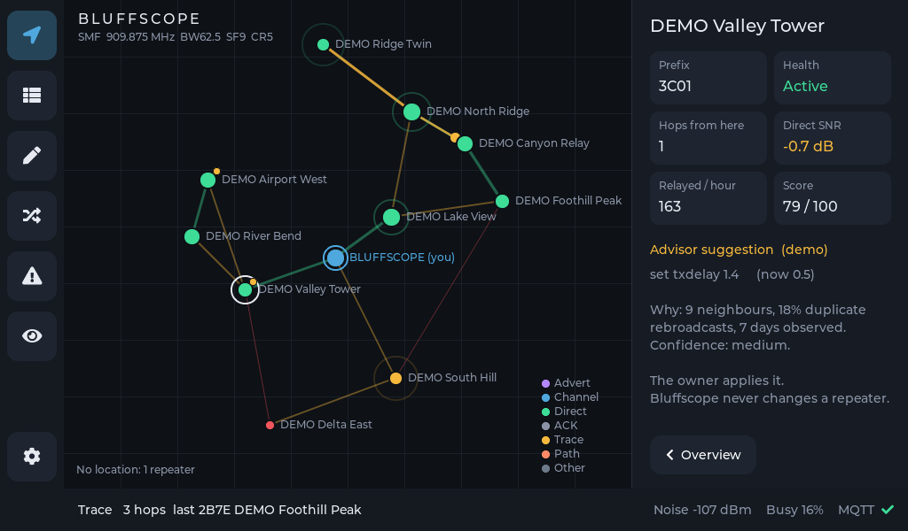
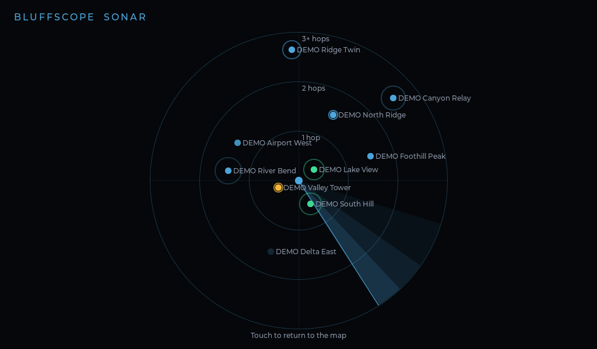

# Bluffscope Mesh Analyzer

A MeshCore repeater + MQTT observer with a 10.1" touch map for the **SMF (Sacramento Valley) mesh**.
Built for the Elecrow CrowPanel Advanced 10.1" (ESP32-P4) with the SX1262 LoRa module.


## What it does

- **Live map:** packets move hop by hop, coloured by type; repeaters coloured by health; links by SNR.
- **Repeater rankings:** a 7-day score from relay share, link SNR, uptime and duplicate rate.
- **Settings Advisor:** suggests `txdelay`, `direct.txdelay`, `rxdelay` and `loop.detect` per repeater from
  observed traffic. **It only suggests.** Owners decide and apply; Bluffscope never changes anyone's node.
  The SMF radio preset (909.875 MHz, BW 62.5, SF9, CR5) is fixed and never touched.
- **Observer:** uploads what it hears to the SMF MQTT broker for [CoreScope](https://scope.sacmesh.org/).
- **Sonar screensaver:** after 2 idle minutes, a sonar view of the repeaters around you.

| Repeater detail | Sonar screensaver |
| --- | --- |
|  |  |

All nodes in the screenshots are invented demo data.

## Status

| Phase | State |
| --- | --- |
| 1. PC simulator: map, panel, sonar with fake traffic | **Working** |
| 2. Board bring-up: screen, touch, microSD, SX1262 | Waiting for hardware |
| 3. MeshCore port (ESP-IDF component) | Not started |
| 4. MQTT observer over the ESP32-C6 | Not started |
| 5. Analytics, rankings, alerts, replay | Not started |
| 6. Settings Advisor + owner notices | Not started |
| 7. Security hardening and first release | Not started |

## Folders

```
ui/        screens and data model, shared by the board and the simulator
sim/       PC simulator with fake SMF traffic
firmware/  ESP-IDF project for the CrowPanel (skeleton)
scripts/   helpers
docs/      design notes and screenshots
```

## Run the simulator (Linux or macOS)

```sh
# Ubuntu/Debian: sudo apt install build-essential cmake libsdl2-dev python3-pil
# macOS:         brew install cmake sdl2 && pip3 install pillow
cd sim
cmake -S . -B build
cmake --build build -j
./build/bluffscope_sim                 # opens a 1024x600 window (click repeaters, Sonar button)
./build/bluffscope_sim --shots out     # or: save screenshots without a window
python3 ../scripts/ppm2png.py out
```

On Windows, use WSL (Ubuntu) and follow the Linux steps.

## Security

No passwords, keys or webhook addresses ever go in this repository. See `docs/DESIGN.md` for the full list.

## License

MIT (see `LICENSE`). Third-party code keeps its own license; LVGL is MIT.
