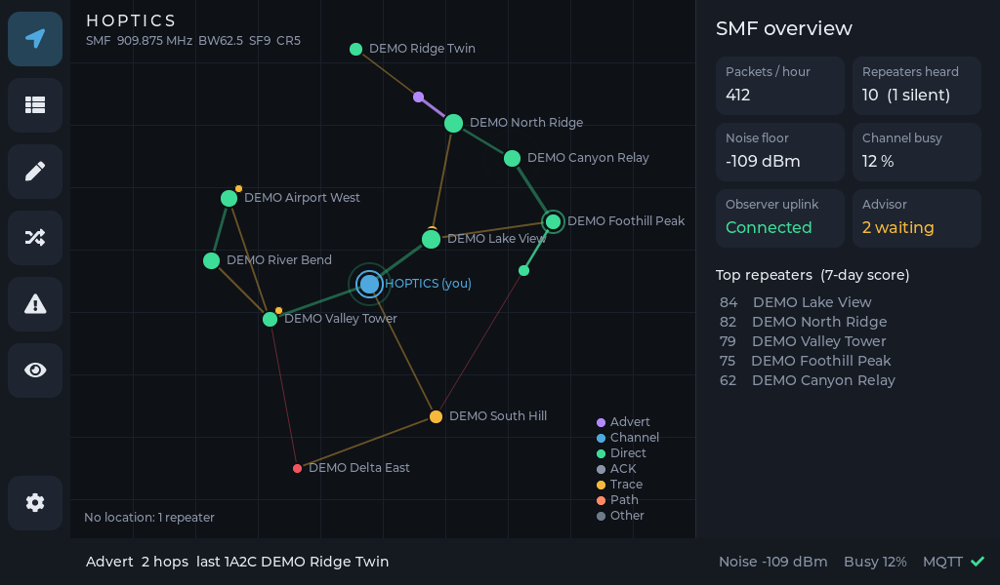

# Hoptics

*Formerly Bluffscope (displays) and Bluffcore (openHop plugin).*

Hoptics is a live dashboard for the **SMF (Sacramento Valley) MeshCore mesh**, in two parts:

- **The Hoptics openHop plugin** runs on a Raspberry Pi repeater. It gathers mesh stats, alerts,
  balloon, APRS, hotspot and weather data and serves one compact, signed data feed.
- **Hoptics displays** show that feed: a full map dashboard on big screens, and lighter
  multi-page versions on small devices. Displays with their own LoRa radio are also MeshCore nodes.



## What it shows

- **Live map:** packets move hop by hop; repeaters coloured by health; links by SNR; range rings around home.
- **Mesh health:** a score for SMF, repeaters online, packets per hour, SNR, airtime and duplicates.
- **Top repeaters:** a ranking from relay share, link SNR, uptime and duplicate rate.
- **Channel strip:** packets per hour against the noise floor, plus longest hop, new nodes and airtime.
- **Alerts:** NWS weather, CAL FIRE incidents and power outages pop up for 45 seconds, ready to send to
  the mesh `#alerts` channel. **Sending is always a manual tap.** Nothing is ever posted automatically.
- **Balloon chase:** live position from your own auto_rx, plus burst ("pop") and landing predictions
  from SondeHub, and a chase line from home to the landing spot.
- **APRS and hotspots:** your APRS beacons and messages, and DMR/YSF last-heard from both WPSD hotspots,
  in one live feed with mesh traffic.
- **Station info:** clock and grid square, space weather and HF band conditions, local weather, next ISS pass.
- **Settings Advisor:** suggests `txdelay`, `direct.txdelay`, `rxdelay` and `loop.detect` per repeater.
  **It only suggests.** Owners decide and apply; Hoptics never changes anyone's node.
  The SMF radio preset (909.875 MHz, BW 62.5, SF9, CR5) is fixed and never touched.
- **Sonar screensaver:** after 2 idle minutes, a sonar view of the repeaters around you.

| Repeater detail | Sonar screensaver |
| --- | --- |
|  |  |

All nodes in the screenshots are invented demo data. The full Map screen design (alerts, balloon,
hotspots, weather) is in the design canvas linked from `docs/DESIGN.md`; the simulator shows the
earlier map layout until that screen is built.

## Devices

| Device | Version |
| --- | --- |
| Elecrow CrowPanel Advanced 10.1" (ESP32-P4 + SX1262) | Full dashboard + mesh node |
| Cardputer Zero over HDMI | Full dashboard (web page from the plugin) |
| Heltec V4 and V4-R8 v2 expansion kits | Compact multi-page + mesh node |
| M5Stack Cardputer, Cardputer Zero's own screen | Lite pages |
| L2 Pro (when it arrives) | Lite, depends on its hardware |

Details, tiers and candidate devices: [`docs/DEVICES.md`](docs/DEVICES.md).
How devices get their data: [`docs/FEED.md`](docs/FEED.md).

## Status

| Phase | State |
| --- | --- |
| 1. PC simulator: map, panel, sonar with fake traffic | **Working** |
| 2. openHop plugin: data feed, alert engine, web dashboard (gives the Cardputer Zero version) | Next |
| 3. CrowPanel bring-up: screen, touch, microSD, SX1262 | Next |
| 4. MeshCore port (ESP-IDF component) | Not started |
| 5. MQTT observer over the ESP32-C6 | Not started |
| 6. Hoptics Map screen: alerts, balloon, APRS, hotspots, weather | Designed |
| 7. Analytics, rankings, Settings Advisor | Not started |
| 8. Compact and lite device builds | Not started |
| 9. Security hardening and first release | Not started |

## Folders

```
ui/        screens and data model, shared by the board and the simulator
sim/       PC simulator with fake SMF traffic
firmware/  ESP-IDF project for the CrowPanel (skeleton)
scripts/   helpers
docs/      design notes, device list, data feed, screenshots
```

Code still uses the `bs_` prefix from the Bluffscope days. It will be renamed in one go later so
the history stays readable.

## Run the simulator (Linux or macOS)

```sh
# Ubuntu/Debian: sudo apt install build-essential cmake libsdl2-dev python3-pil
# macOS:         brew install cmake sdl2 && pip3 install pillow
cd sim
cmake -S . -B build
cmake --build build -j
./build/hoptics_sim                 # opens a 1024x600 window (click repeaters, Sonar button)
./build/hoptics_sim --shots out     # or: save screenshots without a window
python3 ../scripts/ppm2png.py out
```

On Windows, use WSL (Ubuntu) and follow the Linux steps.

## Security

No passwords, keys or webhook addresses ever go in this repository. Every device is built to be
safe once flashed: no default passwords, signed firmware, no open ports. See `docs/DESIGN.md`.

## License

MIT (see `LICENSE`). Third-party code keeps its own license; LVGL is MIT.
